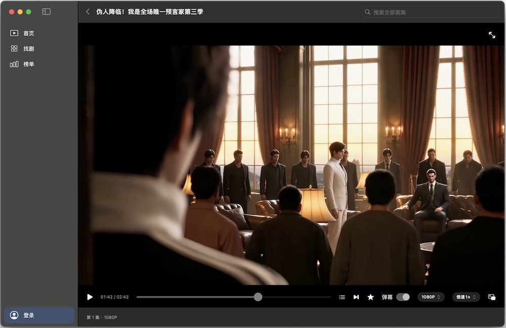
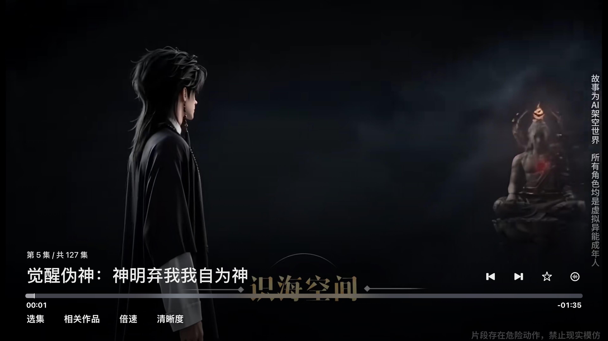

# 红果（Swift 客户端）

红果短剧的原生客户端，纯 Swift 实现，支持 **macOS** 与 **tvOS（Apple TV）** 两个平台，不依赖 JVM、Kotlin 或 Gradle。

- **macOS**：Swift + SwiftUI + AppKit + AVKit，单二进制打包成 `.app`。
- **tvOS**：Swift + SwiftUI + UIKit + AVKit，以 `AVPlayerViewController` 承载播放，使用 Siri Remote 焦点导航。

逻辑层（网络签名、协议、媒体解密、数据模型）跨平台复用，平台相关的 GUI 层各自独立。

## 截图

| macOS                           | tvOS（Apple TV）                 |
| ------------------------------- | -------------------------------- |
|  |  |

## 平台

| 平台  | 最低版本 | 架构           | 说明                                     |
| ----- | -------- | -------------- | ---------------------------------------- |
| macOS | 13.0     | arm64 / x86_64 | 本机临时签名（未公证），供本机或个人分发 |
| tvOS  | 17.0     | arm64          | 仅 App Store / TestFlight 分发，无自更新 |

## 功能

- 首页刷剧：官方综合推荐，支持「推荐 / 真人剧 / 漫剧」频道切换、换一批、上一部 / 下一部，首集试播（点「开始刷剧」才播放，不进入即自动播放）。
- 搜索：全部剧集搜索、分页。
- 找剧：真人剧、漫剧、AI 剧，题材筛选（平铺点选，自动换行）。
- 榜单：综合 / 漫剧 / 真人剧 / AI 热播榜，含排名与热度，多页并发加载。
- 播放器：沉浸式全屏播放，顶部/底部悬浮控件自动隐藏，进度条按帧顺滑刷新，支持 0.5～2 倍速、480/720/1080P 上限（默认自动选最高清晰度）、画中画、投屏、选集面板、评论、弹幕（macOS；tvOS 的投屏/画中画等能力由系统 `AVPlayerViewController` 提供）。
- 收藏与历史：本机片单（收藏、历史）与红果账号片单（账户收藏 / 历史 / 已上线预约 / 待上线预约）分离；收藏按钮按登录态路由到本机或账户。
- 账户：红果官方扫码登录，登录态存于钥匙串（macOS）/ Keychain（tvOS）。
- 评论与弹幕：本集评论（下滑连续加载）、整剧剧评、时间轴弹幕（暂停/拖动/倍速同步）。
- 更新：macOS 检查、下载、校验更新包（`arm` 独立发布，不设 Latest）；tvOS 无自更新。

## 目录结构

```
hongguotvswift/
├── Sources/
│   ├── GUI/            # macOS 前端（AppKit/SwiftUI 视图与平台集成）
│   ├── tvOS/           # tvOS 前端（SwiftUI 遥控器焦点导航 + AVPlayerViewController 播放）
│   ├── Crypto/         # 签名 / 加密 / SM3（纯逻辑）
│   ├── Protocols/      # 协议层（纯逻辑）
│   ├── Media/          # 取流 / 解密 / 编码判断（纯逻辑，AVFoundation）
│   ├── Account/        # 账号 / 设备注册 / 扫码登录（纯逻辑）
│   └── *.swift         # 数据模型 / Model / 存储（纯逻辑，零 AppKit）
├── Resources/          # AppIcon.icns
├── tests/              # 回归测试 + signing.json 金标准
├── scripts/            # 构建与测试脚本
├── docs/               # 设计文档
├── screenshots/        # 界面截图（macOS / tvOS）
├── Info.plist          # macOS 配置
├── TVInfo.plist        # tvOS 配置
├── LICENSE / NOTICE.md / THIRD_PARTY.md
└── README.md
```

> 架构约定：`Sources/` 顶层 + `Crypto/ Protocols/ Media/ Account/` 为**纯逻辑层**，只依赖 Foundation / Combine / Security / AVFoundation，跨 macOS 与 tvOS 复用；`Sources/GUI/`（macOS）与 `Sources/tvOS/`（tvOS）为平台前端，各自独立、互不依赖。

## 构建与运行

### macOS

需 Xcode Command Line Tools（`swiftc`）或完整 Xcode。

```sh
# 构建（产出 outputs/mac/HongGuo.app 与测试 zip）
bash scripts/build-mac-swift.sh
```

打开 `outputs/mac/HongGuo.app` 或拖入「应用程序」。

### tvOS

需完整 Xcode + AppleTVOS SDK（`xcodebuild -downloadPlatform tvOS`）。

```sh
# 构建（默认真机 arm64-apple-tvos；产出 outputs/tvos/HongGuoTV.app）
bash scripts/build-tv-swift.sh

# 构建模拟器版本（arm64-apple-tvsimulator；产出 outputs/tvos-sim/HongGuoTV.app）
bash scripts/build-tv-swift.sh simulator
```

产物需通过 Xcode 安装到 tvOS 真机，或通过模拟器安装运行：

```sh
# 安装并运行到已启动的模拟器
xcrun simctl install booted outputs/tvos-sim/HongGuoTV.app
xcrun simctl launch booted com.hongguotvswift.tv
```

## 测试

```sh
# 加密 / 签名对齐回归（含 signing.json 金标准）
bash scripts/test-mac-crypto.sh

# 编码择优 / AV1 过滤 / 降级顺序 / VideoTracks 回归
bash scripts/test-mac-codec.sh

# 本机记录、云历史、播放控件、评论、弹幕等隔离回归（不联网）
bash scripts/test-mac-local.sh
```

## 数据和账号

- 本机记录存于 `~/Library/Application Support/HongguoTVMac/library.json`；找剧/榜单的缓存存于同目录 `catalog/`（限量缓存，进入栏目先上缓存「架子」，后台刷新）。
- 登录态只存于钥匙串 / Keychain，不写盘、不出现在日志或文档里。
- 手机号、验证码、密码、会话 Cookie 等凭据不会落日志或文档。

## 更新发布

- **macOS**：构建脚本自动生成 `.zip` 与 `mac-update.json`。客户端固定通过 `cdn.gh-proxy.org` 代理读取 GitHub Release 的 `arm` tag 下的 `mac-update.json`（`Info.plist` 的 `CFBundleIdentifier` 为 `com.hongguotv.mac`，正式发布递增 `CFBundleVersion`；调试期间保持版本号不变、以文件名区分 debug 包）。更新只允许 gh-proxy 代理及 GitHub 官方资产 CDN 的 HTTPS 跳转，校验大小与 SHA256 后保存到下载目录，不自动执行或替换应用。
- **tvOS**：无自更新，仅走 App Store / TestFlight 分发。

## 许可

GPL-3.0-only。构建产物包含 LICENSE / NOTICE / 第三方声明；分发时需提供对应源码提交。
